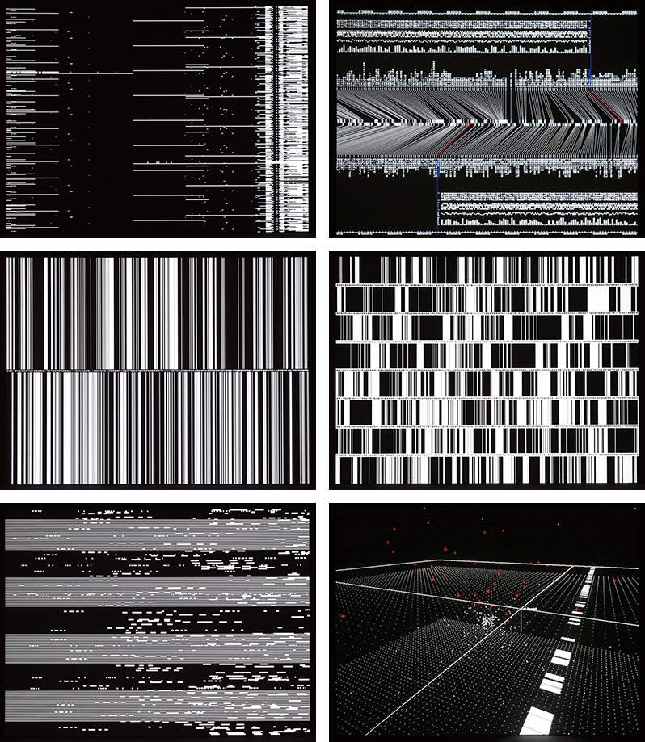

# Modular-synth

A stark drum machine, step sequencer and effects rack for Windows, styled after
Ryoji Ikeda's *datamatics*. Record a live performance, then export it as a master
WAV plus one WAV per instrument.



## Getting the app

1. On this repo's GitHub page, open **Releases** (right-hand side) and click the newest build.
2. Download **Modular-synth-windows.zip**, unzip it, and double-click `Modular-synth.exe`.
3. Windows may warn that the app is from an unknown publisher. Click **More info → Run anyway**.
4. Click **Options** (top-left of the window) to pick your audio output (and a MIDI controller if you have one).

## Playing it

| Do this | To |
| --- | --- |
| `Space` / **PLAY** | start and stop the pattern |
| Click a step | switch it on or off; drag up/down on a lit step to set how hard it hits |
| **P1**-**P4** / `F1`-`F4` | pick a pattern. While playing, the new one waits until the current pattern ends (outlined in blue while it waits) |
| `Shift`+click **P1**-**P4** / `Shift`+`F1`-`F4` | copy the pattern on screen into that slot |
| Click the number box (01-08), or press `1`-`8` / `A S D F G H J K` | hit a pad live (`Shift` = softer) |
| Click a track name | show its controls in the bottom panel |
| Right-click a track name | change its voice or character, or load your own sample |
| **LIVE** / **DIGITAL** / **HR-16** (bottom panel) | switch the selected drum's character |
| Drag a control left/right | change it (`Shift` = fine, double-click = reset). Pitch controls snap to notes; hold `Alt` to go between them |
| **MS** / **NOTE** switches | set a time control in milliseconds or in note lengths that follow the tempo |
| Drag **BPM** / **SWING** up or down | change tempo and swing |
| **M** / **S** | mute / solo a track |
| Click **MASTER** | the master effects rack |
| `R` / **REC** | record a performance (starts the pattern from step 1) |
| **EXPORT** / `E` | save the recording, or the pattern looped, as WAV files |
| `Ctrl+S` / `Ctrl+O` | save / open a project (`.msynth`) |

A MIDI controller also works: notes 36-43 (standard drum pads) or C4-G4 hit pads 1-8.

### The kit

Every drum comes in three characters:

- **DIGITAL**: the stark synthesized datamatics sounds (the default, listed below).
- **LIVE**: modelled acoustic drums: a kick with beater and shell, a metallic hi-hat,
  a snare with wires, a tom with stick and pitch bend, a hand clap.
- **HR-16**: samples from the Alesis HR-16 drum machine (built into the app). The
  SOUND control picks which one: 8 kicks, 13 hats and cymbals, 17 snares and rims,
  6 toms, 12 claps and percussion; TUNE shifts them up to an octave either way.

Pitch controls show the note as well as the frequency, e.g. `E1 41.2 Hz`.

| Track | Voice | Sound |
| --- | --- | --- |
| 01 | KICK | sine with a fast pitch drop, a click, then hard clipping (PITCH, DECAY, DRIVE, CLICK) |
| 02 | CLICK | single-sample impulse, high-passed (DECAY, TONE, NOISE) |
| 03 | NOISE | pure white-noise snare (DECAY, HIPASS, SNAP, COLOR) |
| 04 | SINE | high sine blip (PITCH, LENGTH, SWEEP) |
| 05 | GLITCH | bit-crushed sample-and-hold noise (RATE, BITS, LENGTH) |
| 06 | CLICK | longer, noisier click |
| 07 | SINE | low sine pulse (no steps yet) |
| 08 | SAMPLE | empty: right-click the name to load a WAV/AIFF/FLAC |

### Effects

Every track, and the master, has the same effects rack, in this order:

1. **Bitcrusher**: bit depth and sample-rate reduction.
2. **Distortion**: soft clip, hard clip, wavefold or rectify, with a tone control and dry/wet mix.
3. **Filter**: resonant low-pass.
4. **Delay**: time in ms or note lengths (1/64 to 8 bars, including dotted and triplet).
5. **Grain delay**: chops the past into little overlapping grains. Time and grain size
   in ms or notes, pitch shift (±12 semitones), spray (random scatter), feedback.
6. **Reverb**: decay time in ms or notes (e.g. a tail exactly one bar long), damping.
7. **Psychosis**: up to six OTT-style three-band compressors in a row, squashing loud
   parts down and dragging quiet parts up. Release time in ms or notes.

### Recording and export

Press **REC**, play: hit pads, mute tracks, move any control. Press **REC** or
**STOP** to finish. The app stores what you *did*, not the audio, so the export
can rebuild it perfectly, once for the master and once per track.

**EXPORT** writes a folder containing:

- `<name>_Master.wav`: the full mix after the master effects
- `<name>_01-KICK.wav`, `<name>_02-CLICK.wav`, ...: each track on its own, after its
  own effects **and** its share of the master effects

All files are 24-bit stereo at the app's sample rate, start at the same moment
and have the same length (including the reverb/delay tail), so they line up in
any DAW. Tracks that never made a sound are skipped. Stems added together match
the master, except where the master bitcrusher, distortion or Psychosis is on (they
react to the whole mix, so each stem gets the effect as if it played alone).

## For developers

C++17, [JUCE 8](https://juce.com) (free licence), CMake.

```
cmake -S . -B build              # downloads JUCE automatically
cmake --build build --config Release
build/EngineTests_artefacts/Release/EngineTests            # engine tests
build/EngineTests_artefacts/Release/EngineTests --demo out # render demo WAVs (each character + effects)
```

Pass `-DJUCE_DIR=/path/to/JUCE` to use a local JUCE checkout, and
`-DMS_BUILD_VST3=ON` to also build the VST3 plugin (Milestone 3).

On Linux the app needs: `libasound2-dev libfreetype-dev libfontconfig1-dev
libx11-dev libxrandr-dev libxinerama-dev libxcursor-dev libxext-dev
libxcomposite-dev libgl1-mesa-dev`.

Every push builds the Windows app on GitHub Actions; pushes to `main` publish it
as a release.

### Layout

- `Source/engine`: the instrument with no UI or audio-device code.
  `EngineCore` (sequencer, patterns, voices, mixer, master), `Voice` (every voice
  in its three characters), `Hr16Bank` (the embedded HR-16 samples in
  `assets/hr16`), `FxChain` (effects rack) and `Effects` (grain delay, reverb,
  Psychosis), `OfflineRenderer` (take replay and WAV export),
  `ProjectState` (project data, commands, save/open).
- `Source/app`: `PluginProcessor` runs the engine on the audio thread, receives
  UI commands through a lock-free queue and records them with sample positions;
  `PluginEditor` and `Widgets` are the interface.
- `tests/EngineTests.cpp`: headless tests (timing, determinism, stems summing to
  the master, export files, recorded-event replay, save/open).
